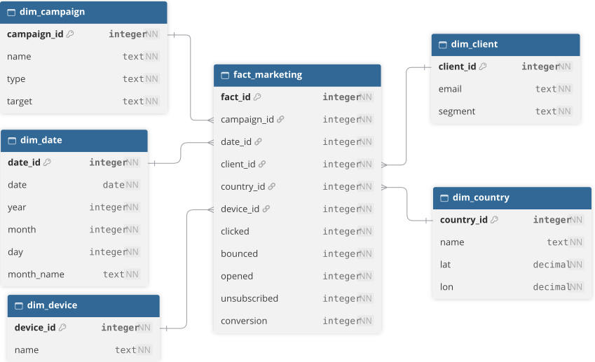
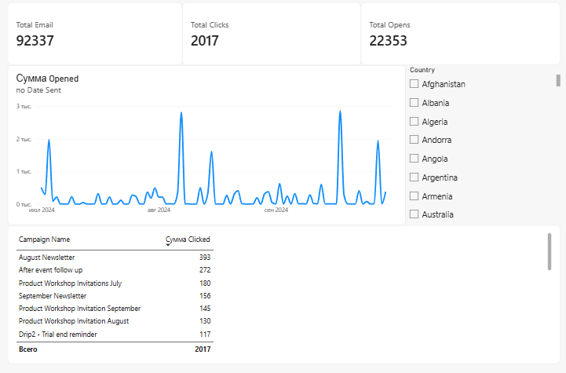

# Marketing Email Campaign Analytics

### О проекте

Репозиторий содержит решение **FP20 Analytics — Skills Builder Series 1: «From Flat Table to Star Schema»**.

Цель проекта — преобразовать исходный датасет маркетинговых email-кампаний в аналитическую модель данных типа **Star Schema («схема звезда»)** с использованием Power BI и Power Query.

**Источник технического задания и датасета:** [FP20 Analytics — Guided Projects](https://fp20analytics.com/guided-projects/).

## Реализованные задачи

### 1. Исследование и подготовка данных

- Проверена структура исходного датасета, содержащего 92 337 записи.
- Проверены типы данных, пропущенные значения и корректность бинарных показателей.
- Обнаружены и исследованы повторяющиеся записи.
- Выявлена и устранена несогласованность регистра в значениях `Device`.
- Отсутствующие значения `Device` выделены в отдельную категорию `Unknown`.
- Проверены функциональные зависимости между атрибутами для последующего проектирования модели.

### 2. Проектирование архитектуры данных

На основе результатов исследования разработана логическая модель **Star Schema**, состоящая из центральной таблицы фактов и пяти таблиц измерений.

Перед реализацией модели в Power Query создана **ER-диаграмма**, определяющая структуру таблиц, первичные и внешние ключи, а также связи между сущностями.

### 3. Реализация модели в Power Query

На основе предварительно спроектированной ER-диаграммы реализованы:

- Таблица фактов `fact_marketing_campaign`, содержащая внешние ключи и показатели взаимодействий с email-письмами.
- Пять таблиц измерений: `dim_campaign`, `dim_client`, `dim_country`, `dim_device`, `dim_date`.
- Суррогатные ключи для таблиц измерений.
- Объединения таблиц через `Merge Queries` для формирования внешних ключей в таблице фактов.

Из итоговой таблицы фактов удалены описательные атрибуты, перенесённые в соответствующие измерения.

### 4. Построение и проверка модели в Power BI

- Настроены связи между таблицами со связями «один ко многим» (1:N).
- Таблица `dim_date` зарегистрирована как Date Table.
- Отключена загрузка промежуточных и диагностических запросов.
- Проверено сохранение количества записей после преобразований и отсутствие пропущенных внешних ключей.

Для проверки работоспособности модели создан интерактивный отчёт **Model Validation**, содержащий:

- KPI-карточки количества записей, кликов и открытий писем.
- Временной график количества открытий.
- Таблицу количества кликов по маркетинговым кампаниям.
- Интерактивный фильтр по странам.

## Использованные технологии

| Технология | Применение |
|---|---|
| Power BI Desktop | Реализация модели данных, настройка связей и визуализация |
| Power Query (M) | Очистка, преобразование и объединение данных |
| DAX | Создание мер и расчёт агрегированных показателей |
| dbdiagram.io (DBML) | Проектирование ER-диаграммы |
| Excel | Источник данных |

## Оригинальное техническое задание

**Источник:** [FP20 Analytics — Guided Projects](https://fp20analytics.com/guided-projects/)

### 1. The Scenario

Your company’s campaign data is poised for rapid growth, and designing a scalable data model is critical for efficient reporting. While the current dataset contains three months of performance metrics, your task is to transform the data into a star schema in Power BI, ensuring it can handle increasing volumes while maintaining optimal performance and usability.

### 2. The Criteria

Prepare the provided dataset by loading, cleaning, and structuring the data into a star schema. This includes creating dimension tables with surrogate keys and linking them to a centralized fact table containing measurable metrics.

### 3. The Deliverables

1. Load and verify the dataset.
2. Create dimension tables.
3. Define relationships between tables.
4. Build and validate the star schema.

## Документация

- [Исследование и качество данных](docs/01_data_profiling.md)
- [Проектирование модели данных](docs/02_data_model.md)

## Файлы проекта

- `powerbi/marketing_campaign.pbix` — модель данных и тестовый отчёт Power BI.
- `diagrams/star_schema.svg` — ER-диаграмма модели.
- `diagrams/star_schema.dbml` — редактируемое описание диаграммы.
- `images/model_validation.png` — скриншот тестового отчёта.

__Для корректного открытия Power BI файла, необходимо изменить параметр DataFolderPath в Power Query, указав путь до директории, в которой лежит таблица с данными__

Проект выполнен в рамках учебной серии **FP20 Analytics Skills Builder**.