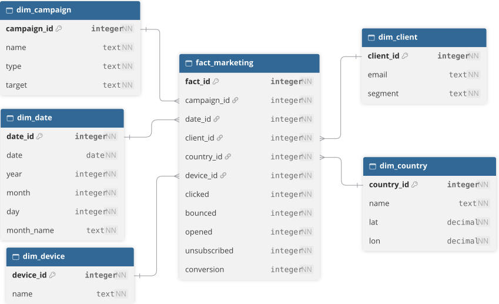

## Проектирование модели данных

## 1. Исследование функциональных зависимостей

Перед проектированием модели были проверены функциональные зависимости между атрибутами исходного датасета.\
Проверки выполнялись в Power Query путём группировки записей и подсчёта количества различных значений зависимых атрибутов.

| Функциональная зависимость          | Результат |
|-------------------------------------|---|
| `Campaign Name -> Campaign Type`    | Выполняется |
| `Campaign Name -> Conversion Target` | Выполняется |
| `Client Email -> Client Segment`     | Выполняется |
| `Country -> (Latitude, Longitude)`   | Выполняется |

В исследуемом датасете каждому названию кампании соответствует один тип и одна цель конверсии. Аналогично каждому клиенту соответствует один сегмент, а каждой стране — одна пара координат.

**Принятое решение:** связанные атрибуты объединены в соответствующие таблицы измерений без выделения дополнительных справочников типов кампаний, сегментов клиентов и целей конверсии.

Это позволило создать модель Star Schema вместо более нормализованной Snowflake Schema.

## 2. Архитектура Star Schema

Спроектирована модель, включающая центральную таблицу фактов `fact_marketing_campaign` и пять таблиц измерений:

- `dim_campaign`
- `dim_client`
- `dim_country`
- `dim_device`
- `dim_date`

### ER-диаграмма

Исходный файл диаграммы: [star_schema.dbml](../diagrams/star_schema.dbml).

## 3. Таблицы измерений

### 3.1. dim_campaign

Одна строка на маркетинговую кампанию.

| Поле | Назначение |
|---|---|
| `Campaign_id` | Суррогатный первичный ключ |
| `Campaign Name` | Название кампании |
| `Campaign Type` | Тип кампании |
| `Conversion Target` | Цель конверсии |

По результатам исследования атрибуты `Campaign Type` и `Conversion Target` функционально зависят от `Campaign Name`, поэтому хранятся в одном измерении.

### 3.2. dim_client

Одна строка на уникальный email получателя.

| Поле | Назначение |
|---|---|
| `Client_id` | Суррогатный первичный ключ |
| `Client Email` | Email получателя |
| `Client Segment` | Сегмент клиента |

Для текущего датасета подтверждено, что каждому email соответствует один сегмент.

При обновлении данных необходимо учитывать потенциальное изменение сегмента клиента во времени.

### 3.3. dim_country

Одна строка на страну.

| Поле | Назначение |
|---|---|
| `Country_id` | Суррогатный первичный ключ |
| `Country` | Название страны |
| `Country Latitude` | Широта |
| `Country Longitude` | Долгота |

Координаты хранятся в таблице измерения, поскольку являются атрибутами страны.

### 3.4. dim_device

Одна строка на категорию устройства.

| Поле | Назначение |
|---|---|
| `Device_id` | Суррогатный первичный ключ |
| `Device` | Название категории устройства |

При подготовке данных значения устройства приведены к единому регистру.

Поскольку примерно 50% исходных записей не содержат информации об устройстве, пропущенные значения заменены на отдельную категорию `Unknown`.

Несмотря на небольшое количество атрибутов, `dim_device` оставлена отдельным измерением для сохранения единой архитектуры Star Schema.

### 3.5. dim_date

Одна строка на календарный день.

| Поле | Назначение |
|---|---|
| `Date_id` | Ключ календарного измерения |
| `Date Sent` | Календарная дата |
| `Year` | Год |
| `Month` | Месяц |
| `Day` | День месяца |

В Power BI таблица зарегистрирована как **Date Table**, а столбец `Date Sent` назначен календарным столбцом.

## 4. Таблица фактов

### fact_marketing_campaign

Таблица содержит внешние ключи для связи с измерениями и показатели взаимодействия получателей с email-кампаниями.

| Поле | Назначение          |
|---|---------------------|
| `Campaign_id` | FK -> dim_campaign  |
| `Client_id` | FK -> dim_client     |
| `Country_id` | FK -> dim_country    |
| `Device_id` | FK -> dim_device     |
| `Date_id` | FK -> dim_date       |
| `Clicked` | Бинарный показатель |
| `Bounced` | Бинарный показатель |
| `Opened` | Бинарный показатель |
| `Unsubscribed` | Бинарный показатель |
| `Conversion` | Бинарный показатель |

## 5. Реализация модели

Модель реализована с использованием **Power Query (M)**.
Загрузка исходного и диагностических запросов в итоговую модель отключена. Они продолжают использоваться для подготовки данных, но не отображаются в аналитической модели Power BI.

## 6. Проверка корректности модели

После реализации выполнены следующие проверки:

- Количество записей таблицы фактов совпадает с количеством записей исходного датасета.
- Во внешних ключах отсутствуют пропущенные значения.
- Ошибок преобразования данных не обнаружено.
- Создан тестовый отчёт Power BI для проверки агрегаций по кампаниям и датам, а также интерактивной фильтрации по странам.

## 7. Ограничения и дальнейшее развитие

- Отсутствие уникального идентификатора отправки затрудняет однозначную идентификацию событий.
- Функциональные зависимости подтверждены только на текущих данных.
- При изменении сегмента клиента во времени может потребоваться историзация атрибутов (например, Slowly Changing Dimensions).
- Суррогатные ключи, созданные с помощью индексирования, могут изменяться при обновлении набора измерений.
- Причина пропусков в поле `Device` не установлена.

Разработанная модель используется как основа для дальнейшего исследования эффективности email-кампаний и построения аналитических отчётов.